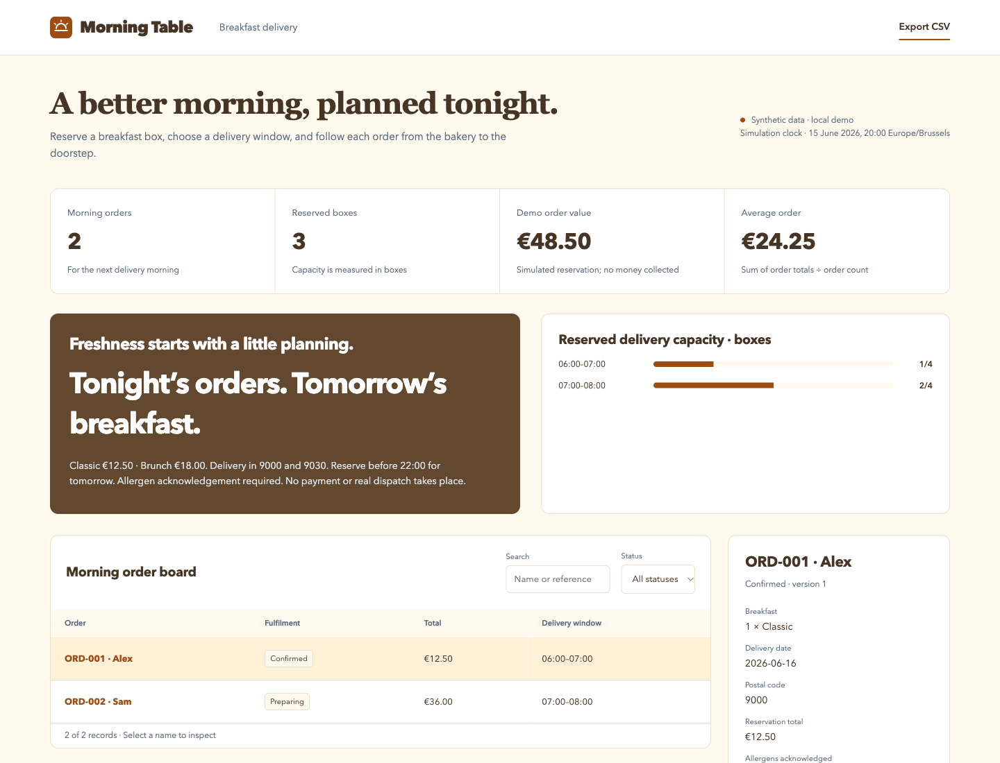

# Morning Table

A breakfast reservation and fulfilment demo with server-side prices, atomic delivery capacity and an end-to-end order board.

[](https://github.com/phlppgdfry/breakfast-delivery-platform/actions/workflows/demo.yml)



## Run it in one command

Requires Python 3.11+ with SQLite support. No pip install, account, API key or Node runtime is needed to run the application.

```bash
git clone https://github.com/phlppgdfry/breakfast-delivery-platform.git
cd breakfast-delivery-platform
python3 -m demo.server
```

Open **http://127.0.0.1:8115**. The first start seeds `var/demo.sqlite3`; later starts preserve changes. The server binds to loopback only.

Use a new database path for a fresh workspace, without overwriting existing work:

```bash
python3 -m demo.server --port 8215 --db var/fresh-demo.sqlite3
```

## Try the complete workflow

1. Reserve three Classic boxes for a fictional customer in 9000, in the 06:00–07:00 window. Acknowledge the displayed allergens.
2. The total is €37.50. Advance the order through preparation, delivery handover and delivered.
3. Try another box in the same window: the seeded one plus your three have exhausted the four-box capacity. Reload to verify the order persists.

Search and status filtering, record inspection, CSV export, input errors, an activity log, responsive layouts, individual SVG branding, favicons and Apple touch icons are included.

## Why this project exists

Scheduled breakfast delivery needs a reservation model that prevents oversold delivery windows and gives operators a clear fulfilment sequence.

The implementation completes one demonstrable product slice, with explicit business rules and verifiable state changes. This is a **local portfolio demonstration with synthetic data**, not an operating service or evidence of client outcomes.

## Business rules

- Fixed demo clock = 15 June 2026, 20:00 Europe/Brussels. Tomorrow delivery is 16 June. Ordering is rejected from 22:00 Brussels time, including when the injected clock uses another timezone.
- Delivery zones: 9000 and 9030. Two windows each accept four boxes; occupancy sums quantities, including already fulfilled orders for that date.
- Classic costs 1,250 cents; Brunch 1,800 cents. The server calculates the total using integer cents and ignores client-supplied totals.
- The order must acknowledge the displayed allergens. State machine: confirmed → preparing → out_for_delivery → delivered; the server derives the next state.

## Verify and reproduce

```bash
make check                 # domain, HTTP, transaction and concurrency tests + syntax checks
make report                # deterministic baseline JSON and CSV; does not modify the database
```

Node 24+ is used only for JavaScript syntax checks and browser verification. The browser suite has a pinned development dependency:

```bash
npm ci
npx playwright install chromium
npm run test:e2e
```

The six Chromium tests start an isolated Python server and temporary database, then clean it up. They cover branding/assets, filtering, 390/768/1440 px widths and the complete domain workflow. GitHub Actions also runs Python tests on 3.11 and 3.14. See [validation evidence](docs/validation.md).

Baseline evidence is committed in [reports/baseline/snapshot.json](reports/baseline/snapshot.json) and [records.csv](reports/baseline/records.csv). These are generated from the fixtures, not a screenshot of arbitrary runtime state.

## Engineering decisions

**Make capacity a transaction invariant.** BEGIN IMMEDIATE covers the occupancy check, insert and audit entry; simultaneous requests for the last box cannot both commit.

**Use integer money.** Prices and totals use cents so order arithmetic is exact. There is no payment integration or charge.

**Use an injectable business clock.** Cutoff and timezone tests are deterministic; the demo stays usable regardless of the reviewer’s current time.

The browser uses semantic HTML, native JavaScript modules and CSS. The Python application separates input contracts, domain rules, transactional persistence and HTTP transport. Records use optimistic version checks; each mutation and its audit entry commit together. Rejected actions leave both unchanged.

## Scope and evidence

Reservations and deliveries are simulated. No payment, real bakery order, routing optimisation, AI recommendation, real courier tracking, supplier integration or food-safety process is performed.

The June concept is retained in [original-concept.md](docs/original-concept.md), explicitly labelled as unverified history. Current functionality is defined by the source, tests and this README. The demo has no authentication or tenant boundaries; use fictional data and keep it local.

## Explore the repository

| Resource | Purpose |
| --- | --- |
| [demo/domain.py](demo/domain.py) | Fixtures, calculations and use cases |
| [demo/store.py](demo/store.py) | SQLite transactions, optimistic versions and audit log |
| [demo/web/feature.js](demo/web/feature.js) | Domain-specific forms and details |
| [tests](tests) | Domain, persistence, HTTP and browser verification |
| [Architecture](docs/architecture.md) | Boundaries, tradeoffs and data flow |
| [API contract](docs/api.md) | Routes, payloads and errors |
| [Case study](docs/case-study.md) | Problem, acceptance criteria and delivery scope |
| [Runbook](docs/runbook.md) | Start, inspect, export and recover |
| [Mobile preview](docs/mobile.png) | 390 px workspace |

Built by [Philippe Godfroy](https://github.com/phlppgdfry).
